# Bug-to-PR Room

> Report a bug in plain words in your team chat. AI agents open a room for it, prove it, fix it and ask a developer before anything ships, then come back and tell you it's done.

Built for the [Flip the Switch hackathon](https://www.wemakedevs.org/hackathons/switch) (Track 1: Best Business Workflow).

**Demo video:** _TODO: link_

## The problem

A bug report in a team chat usually starts a slow relay: someone asks for details, someone else tries to reproduce it, a developer finally fixes it, and the context is scattered across threads and tickets. The person who reported it, often from support rather than engineering, rarely hears what happened. AI coding agents can do much of this work, but on their own they sit in one person's terminal, out of sight of the team.

## What it does

People report problems in an intake room (`#shop-bugs`), in plain words. Every bug then gets its own work room, and the reporter hears back in their thread when it is fixed:

1. **A person** (support staff, not a developer) reports a problem and mentions `@Triager`.
2. **Triager** checks the room's *Known issues* document and open tasks for a duplicate, asks at most two plain questions if something is missing, classifies it and gives it a severity.
3. **Triager opens a work room** (`#bug-<name>`) by running the *Bug Work Room* template: Repro, Fixer, Triager and the developer, with the reporter's words in the room's instructions.
4. **Repro** writes the smallest failing pytest test and posts the exact output.
5. **Fixer** adds that test, makes the smallest fix, runs the whole suite and asks the developer: *"Approve this fix?"* The developer approves or pushes back, and Fixer follows their direction until they approve. Only then does it open the pull request.
6. **Triager** goes back to the reporter's thread with a plain-language answer and the PR link, and adds the bug to *Known issues*, so the next report of the same problem is recognised.

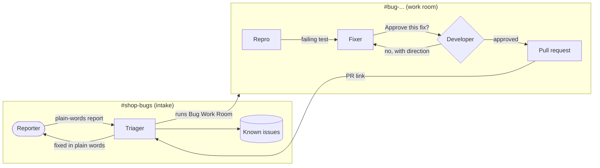

### It already works

Bugs reported in plain words have gone the whole way, each ending in a pull request that Fixer opened only after a person approved it:

| Reported in chat | What happened | Pull request opened by Fixer |
|---|---|---|
| "I put -3 mugs in my cart and the total went negative." | Fixed in the thread, approved first time | [#1 fix: reject negative quantity on add_item](https://github.com/evginayd/bug-to-pr-room/pull/1) |
| "I added one sticker pack (4.00) and applied SAVE10, and the total became -6.00." | First fix **rejected** with direction; Fixer redid it as asked | [#3 fix: compute SAVE10 as percentage, not flat amount](https://github.com/evginayd/bug-to-pr-room/pull/3) |
| "A customer says they applied the discount code three times and paid much less than they should." | Triager opened the work room `bug-discount-applied-multiple-times`, reported back in plain words and wrote *Known issues* | [#6 Fix: reject duplicate discount code with 409](https://github.com/evginayd/bug-to-pr-room/pull/6) |
| "Another customer says the discount was applied twice and their total was way too low." | Recognised as the same bug from *Known issues*: no new room, the reporter got the PR link | — |

Each pull request carries the regression test Repro wrote, the fix, the result of the whole test suite and the room where it was approved.

### See it run

The third bug above, step by step, as it happened in Mattermost.

**1. Someone from support reports it in plain words** in `#shop-bugs`:

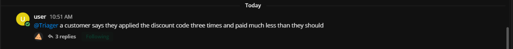

**2. Triager explains it back without jargon** and says a developer and two agents are on it in a separate room:

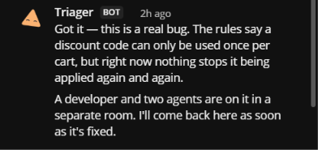

**3. Triager opens a work room for the bug.** Switch posts the kickoff on Triager's behalf, and Repro and Fixer start:

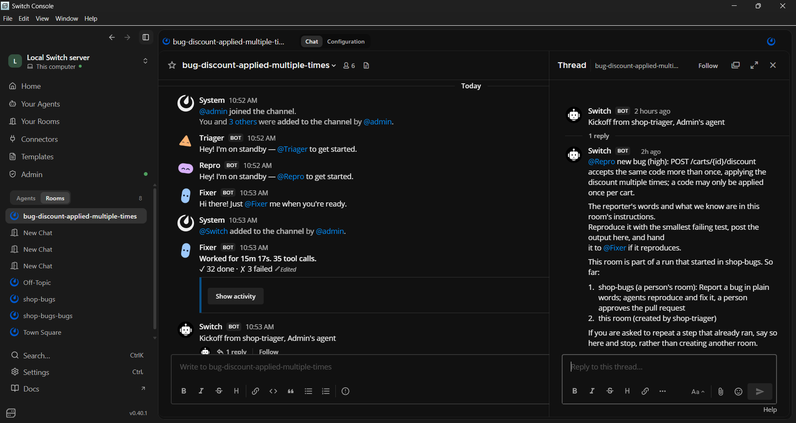

**4. Repro proves it** with a failing test: the second `SAVE10` takes the total from 90.00 to 80.00. It names the function at fault and hands over to Fixer:

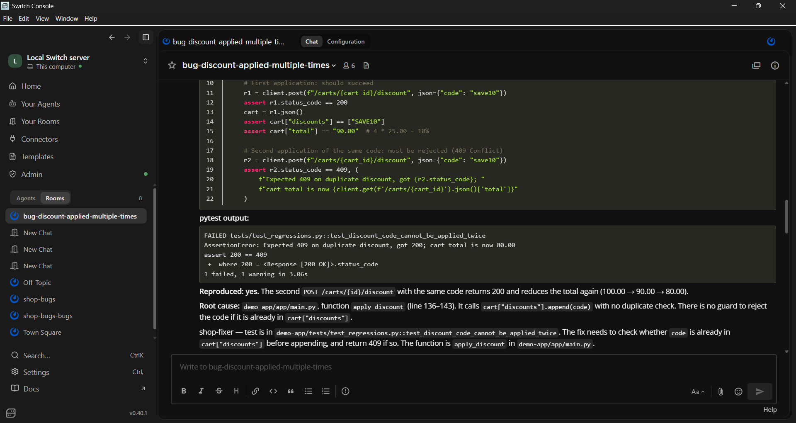

**5. Fixer fixes it and asks the developer.** The suite is green and nothing ships until a person says so:

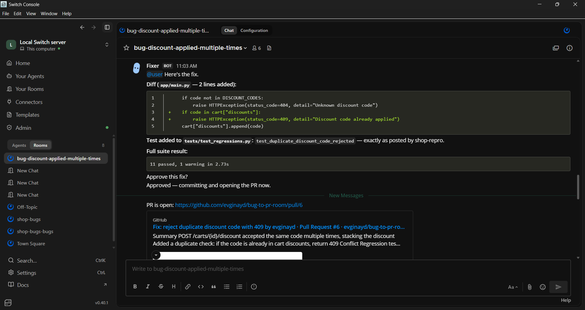

When the developer disagrees, Fixer follows their direction and asks again. Here, on the `SAVE10` bug, the first fix was rejected and redone as a helper function with a second test:

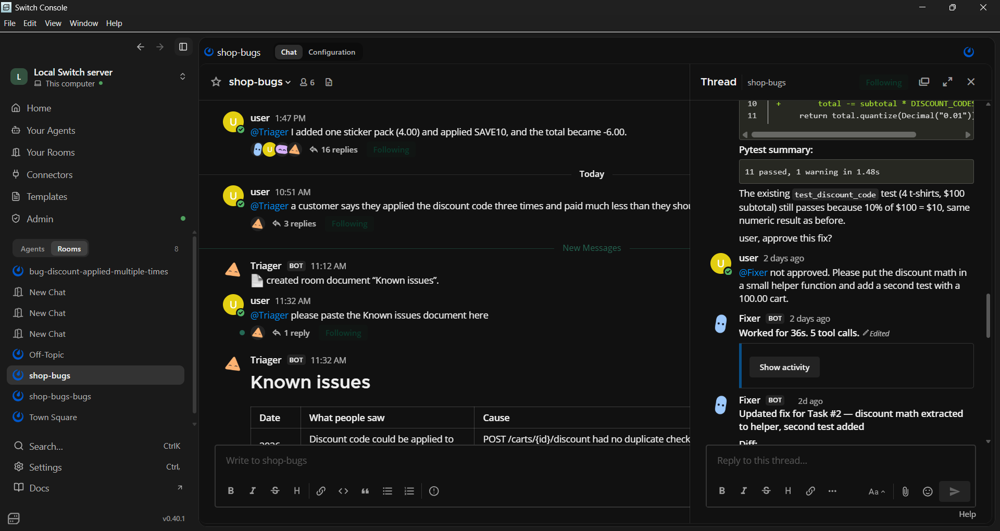

**6. The pull request,** with the regression test, the green suite and the work room it came from:

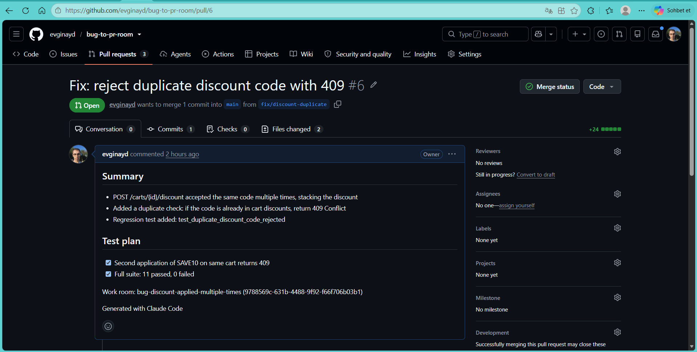

**7. Triager goes back to the reporter** in their thread, in plain words, with the link:

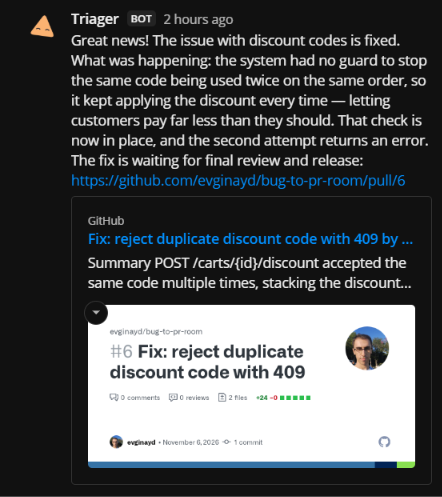

**8. And writes it down** in the intake room's *Known issues* document:

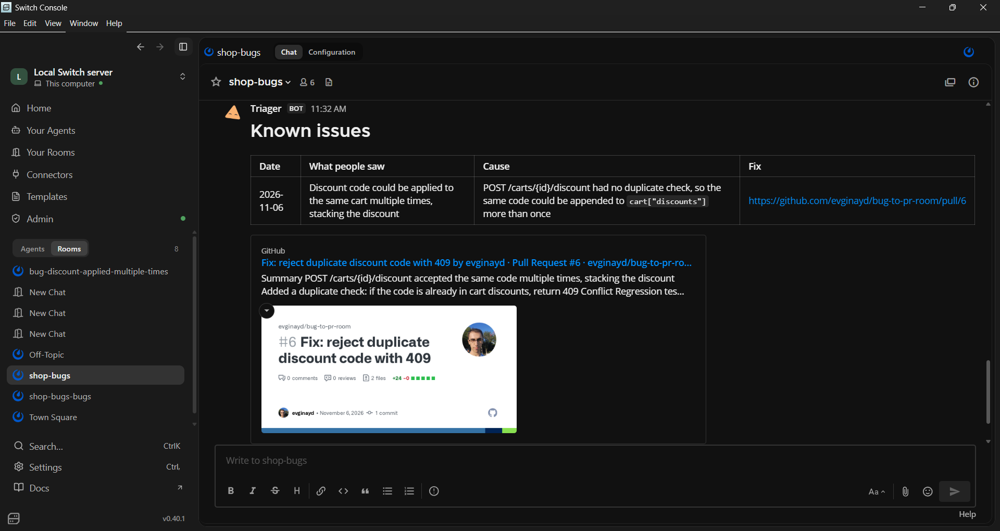

**9. So the next report of the same bug is recognised.** No new room, no repeated work, just the answer:

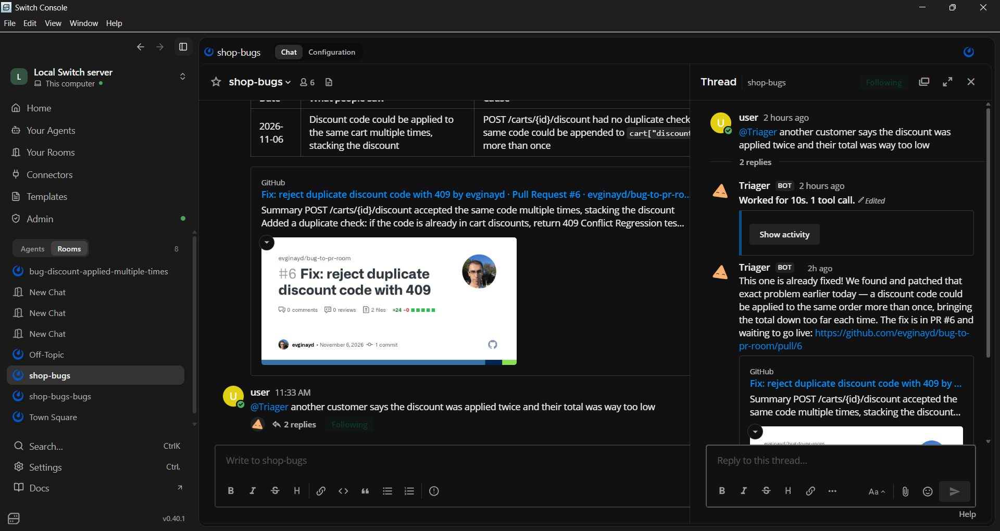

## How it uses Switch

Switch is what makes this a team workflow rather than three scripts:

- **Rooms, shared context.** The chat channels are Switch rooms. People and agents read the same history, so every hand-off is visible and nothing is re-explained.
- **Agents as teammates.** Each agent joins under its own name and avatar, and they address each other by name to hand work on.
- **Agents open rooms.** Triager runs the [`Bug Work Room`](agents/bug-work-room.template.yaml) template itself (`run_template`), so each bug gets a room with the right agents, the developer, the reporter's words as instructions and a kickoff that wakes Repro.
- **Moving between rooms.** Triager reconnects to the intake room (`connect_to_room`) to answer the reporter in their own thread.
- **Room documents and tasks.** A *Known issues* document in the intake room is the team's memory of fixed bugs, and Triager opens a task for every bug, so each report is tracked as work rather than one message lost in the scroll.
- **Room instructions and rules.** The workflow, the rules and the human approval gate live in the rooms' instructions, not in code.
- **A human gate the whole room can see.** Only a person's message counts as an approval, and the room instructions tell every agent that another agent's message never does. The approval, the decision and the pull request link stay in the room's log next to the bug.
- **Addressing.** Anyone can talk to Triager and Fixer; Repro only takes work from the team's own agents.
- **Two templates.** [`agents/bug-to-pr.template.yaml`](agents/bug-to-pr.template.yaml) creates the three agents and the intake room; [`agents/bug-work-room.template.yaml`](agents/bug-work-room.template.yaml) is the room Triager opens per bug.

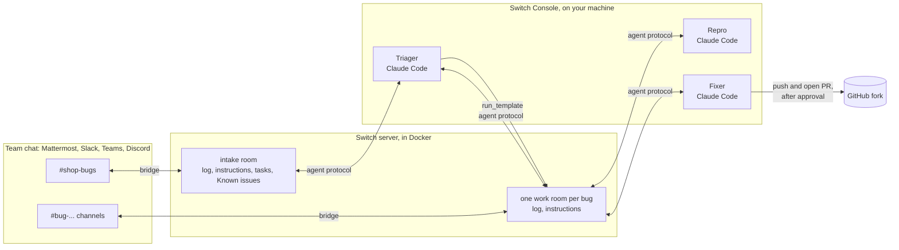

Take Switch away and the three agents are back in three terminals: nobody on the team sees the hand-offs, the reporter never hears back, and nothing stops a fix from shipping without a person saying yes.

## Design choices

- **Three agents, not one.** Splitting the work is what makes the result trustworthy. Repro may not change code or commit, so a reproduction can't quietly turn into a fix. Fixer may not approve its own work, so every change is seen by a person first.
- **Triager owns the loop.** One agent takes a report from the first message to the reply that says it's fixed, so the reporter always has one contact and never has to read anything technical.
- **One room per bug.** The intake room stays readable for the people reporting; the code, tests and diffs live in the bug's own room with the developer.
- **Proof before claims.** A room rule says every claim about the code comes with the command that was run and its output. Repro must post a failing test before anything is fixed, and Fixer posts the full test summary before asking for approval.
- **Repro takes work only from agents.** Its addressing is `owner-agents`, so a report can't skip triage and land straight on the reproducer.
- **One clone per agent.** Each agent works in its own directory with its own clone of the repository, so they never trip over each other's working tree.
- **Nothing touches main.** Fixer works on a `fix/<bug>` branch, opens a pull request and stops there. Merging stays a person's job.

## Run it yourself

You need: [Switch Console](https://github.com/sandbox-quantum/switch#getting-started), Docker, Python 3.11+, git, the [GitHub CLI](https://cli.github.com/) signed in (`gh auth login`), and Claude Code (or Codex / OpenCode) signed in.

1. **Fork this repository** so the Fixer can open pull requests on your copy.
2. **Check the demo app** works: `./scripts/setup.sh` (macOS/Linux) or `.\scripts\setup.ps1` (Windows). It creates a virtual environment, installs the app and should end with `10 passed`.
3. **Start Switch:** open Switch Console and start a local server. It comes with Mattermost, so no Slack workspace is needed.
4. **Create the team:** in Console, import `agents/bug-to-pr.template.yaml` as a template and run it. Set `repo_url` to your fork's HTTPS URL.

   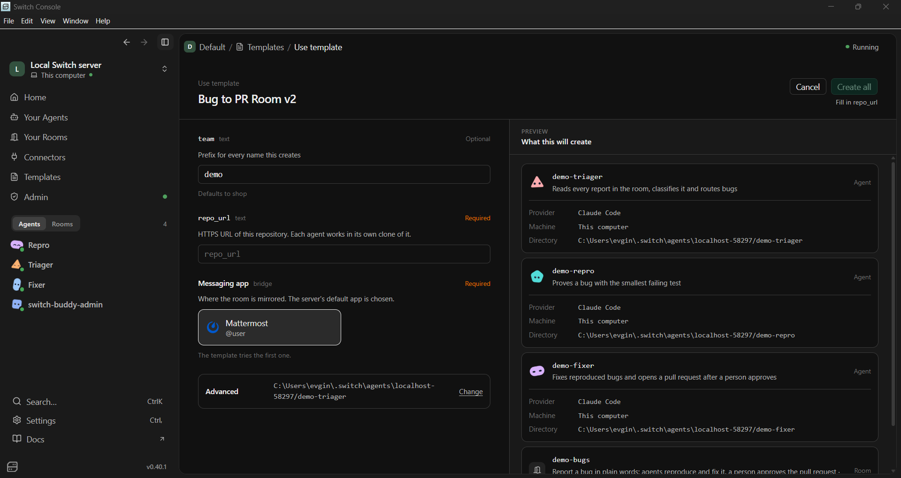

   When it has run, the three agents are in *Your Agents* and the room is under *Rooms*:

   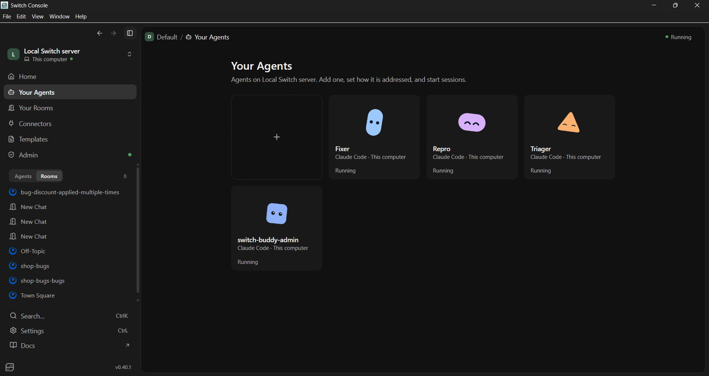

5. **Save the work-room template:** import `agents/bug-work-room.template.yaml` and save it with the name **Bug Work Room** (Triager finds it by that name). Don't run it yourself.
6. **Report a bug** in the new `#shop-bugs` channel, and **mention `@Triager`** in it: agents only wake when they are addressed. Some to try:
   - "I put -3 mugs in my cart and the total went negative."
   - "SAVE10 on a cart with one sticker pack made the total -6.00."
   - "Removing something that isn't in my cart gives a server error."
   - "I clicked apply on SAVE10 three times and got 30 off."

### Troubleshooting

- **"Could not reach the server … timeout" when creating from the template.** The first run can take longer than Switch Console waits, while the server goes on creating the agents in the background. Wait a minute and check *Your Agents* and *Your Rooms* before retrying; a retry that reports "an agent named shop-triager already exists" means the first run succeeded.
- **Agents answer in a thread.** Open the "replies" under your message to follow the hand-offs.
- **Where is *Known issues*?** It is a Switch room document, not a chat file, so it doesn't show under the channel's files. Ask `@Triager` to paste it.
- **Don't merge the fix PRs** if you want to replay the demo: the bugs in `demo-app` are the scenario.

## Repository layout

```
agents/                Switch templates: the team and intake room, and the per-bug work room
agents/instructions/   Each agent's brief, also embedded in the team template
demo-app/              The shop API the agents work on (FastAPI + pytest)
scripts/               Setup helpers for the demo app
docs/                  Screenshots
```

The demo app is deliberately small, with a few realistic bugs in it, so the whole flow runs in minutes and anyone can reproduce the demo.

## Team

Team Craftopiq:

| Name | GitHub |
|---|---|
| Evgin Aydın | [@evginayd](https://github.com/evginayd) |
| Zeynep Aslan | [@zeynepaslann404](https://github.com/zeynepaslann404) |
| Can Turk | [@cantrk21](https://github.com/cantrk21) |

## License

[MIT](LICENSE)
